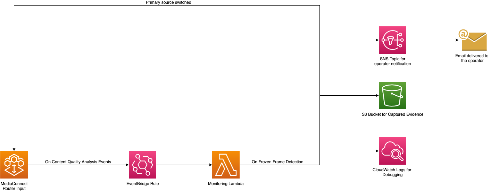

# MediaConnect Router Content Quality Analysis Automation

Automatically fail over an AWS Elemental MediaConnect Router input when its content quality degrades, capture evidence of the incident, and notify an operator.

> **Disclaimer:** This sample project is solely intended for educational and evaluation purposes. Review, test, and harden it before using it in production. Evaluate it against your security requirements. The software is provided "as is", without warranty of any kind.

## Introduction

Live video can remain connected while delivering degraded content. Frozen frames, black frames, and silent audio require a fast response even when the transport connection stays healthy. AWS Elemental MediaConnect Router content quality analysis detects these conditions on a Router input.

This sample deploys a failover Router input with primary and secondary RTP sources. When the active primary source reports frozen frames, the solution automatically:

- Changes the input's preferred source from the primary source to the secondary source
- Captures a Router input thumbnail and source transport-stream metadata in Amazon S3
- Publishes an Amazon SNS email notification containing the S3 evidence paths
- Logs the event and each action in Amazon CloudWatch Logs

## Architecture



The CloudFormation template creates:

- A public MediaConnect Router network interface restricted to the source CIDR you provide
- A globally routable `INPUT_50` Router input in the first Availability Zone of the stack Region
- Two RTP source configurations on ports `20000` and `20001`, with forward error correction disabled
- Primary/secondary source priority, with source index `0` initially preferred
- Frozen-frame content quality analysis with a default threshold of 30 seconds
- An EventBridge rule scoped to the Router input and `frozenFrames: DETECTED` events
- A Lambda function that changes the preferred source to index `1`, captures evidence, and publishes a notification
- An encrypted SNS topic and email subscription
- Versioned, encrypted S3 evidence and access-log buckets with public access blocked
- A lifecycle custom resource that starts the Router input after stack creation and stops it before deletion

## Prerequisites

- AWS CLI v2, configured with credentials and a default Region, or a named profile with a Region configured
- A Region where MediaConnect Router is available
- Permissions to create and manage MediaConnect Router, Lambda, IAM, S3, EventBridge, SNS, and CloudWatch Logs resources
- Two RTP video sources that can reach the Router input's public IP address and ports.
- An email address where you can confirm the SNS subscription and receive notifications

## Deploy

```bash
./deploy.sh <ARTIFACTS_BUCKET> <STACK_NAME> <SOURCE_CIDR> <NOTIFICATION_EMAIL> [FROZEN_FRAME_THRESHOLD] [AWS_PROFILE]
```

- `ARTIFACTS_BUCKET` – S3 bucket used to stage the packaged Lambda zip. The script creates it if it does not exist.
- `STACK_NAME` – CloudFormation stack name.
- `SOURCE_CIDR` – Public IPv4 CIDR allowed to send video to the Router input, for example `203.0.113.0/24`. Restrict this to your encoder addresses.
- `NOTIFICATION_EMAIL` – Email address that receives failover notifications.
- `FROZEN_FRAME_THRESHOLD` – Optional duration in seconds before an alert fires. Valid values are 10–60; the default is 30.
- `AWS_PROFILE` – Optional named AWS CLI profile.

Example:

```bash
./deploy.sh <your-artifacts-bucket> mediaconnect-router-cqa-demo 203.0.113.0/24 operator@example.com 30
```

After deployment, Amazon SNS sends a confirmation message to `NOTIFICATION_EMAIL`. Open that message and confirm the subscription. Notifications are not delivered until the subscription is confirmed.

The script prints the Router input ARN, ingest IP and ports, evidence bucket, SNS topic, Lambda function, and EventBridge rule.

## Verify the deployment

Add `--profile <AWS_PROFILE>` to the following commands if you deployed with a named profile.

Confirm the stack completed successfully:

```bash
aws cloudformation describe-stacks \
  --stack-name <STACK_NAME> \
  --query 'Stacks[0].StackStatus' \
  --output text
```

The status should be `CREATE_COMPLETE` for a first deployment or `UPDATE_COMPLETE` for an update. Any `ROLLBACK` status means deployment failed; inspect the stack events for the cause.

## Test failover

Retrieve the shared ingest IP and the two source ports from the stack outputs. Send the primary RTP stream to port `20000` and the secondary RTP stream to port `20001` on the same ingest IP. The sample disables RTP forward error correction.

Produce frozen video on the primary source while keeping its transport connection active. After the configured threshold is breached, verify that:

1. The Router input's `Configuration.Failover.PrimarySourceIndex` changes from `0` to `1`.
2. The confirmed email subscription receives a failover notification.
3. The notification identifies the Router input and lists any captured evidence as `s3://` paths.
4. The evidence bucket contains a timestamped `.jpg` thumbnail and `.json` source-metadata object with a shared base key.
5. The monitoring Lambda's CloudWatch Logs record the event and actions.

Evidence capture and notification are best-effort. A failure in either operation is logged but does not reverse a successful source change.

After a test, use the MediaConnect console to set the preferred source back to the first source before repeating the test. If frozen frames are detected while source index `1` is already preferred, the function captures evidence and logs that no additional healthy failover target is configured.

## Tear down

> **Warning:** This permanently deletes all captured thumbnails, metadata, and access logs from the stack-created S3 buckets. Back up any files you want to retain.

```bash
./delete_stack.sh <STACK_NAME> [AWS_PROFILE]
```

The script empties the versioned S3 buckets and deletes the stack. During deletion, the lifecycle custom resource stops the Router input before CloudFormation removes it. The artifacts bucket remains in place.

## Cost

This template creates resources that may incur charges, including an active AWS Elemental MediaConnect Router input, Lambda invocations, S3 storage, SNS delivery, and CloudWatch Logs. Costs vary by Region, input tier, data transfer, and runtime. Delete the stack when finished and review [AWS Elemental MediaConnect pricing](https://aws.amazon.com/mediaconnect/pricing/).

## Extending the sample

Possible extensions include:

- Add a Router output and assign this input to it with the `TakeRouterInput` API.
- Add EventBridge handling for black frames, silent audio, or missing streams.
- Publish notifications to operational tooling instead of, or in addition to, email.
- Use a VPC Router network interface for private source connectivity.

## Contributing

See [CONTRIBUTING](CONTRIBUTING.md) for more information.

## Security

See [CONTRIBUTING](CONTRIBUTING.md#security-issue-notifications) for more information.

## License

This library is licensed under the MIT-0 License. See the [LICENSE](LICENSE) file.
